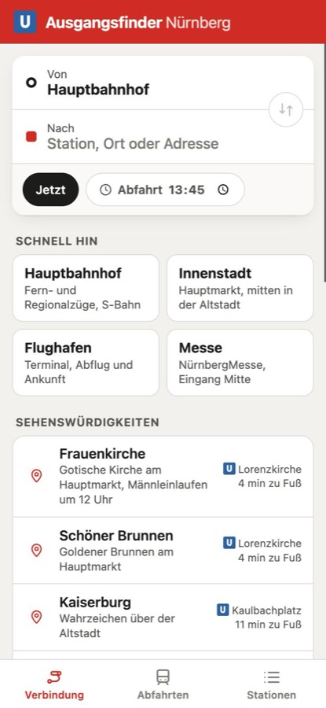
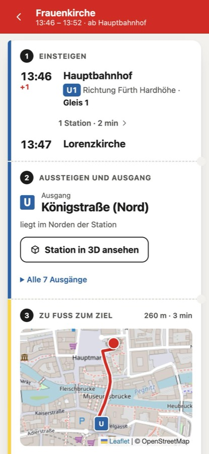
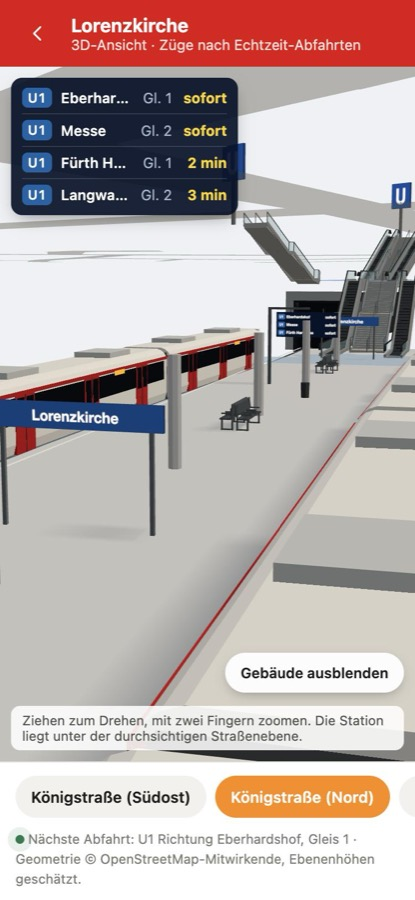

# VAGExit

Fahrplanauskunft für die Nürnberger U-Bahn, die nicht am Bahnsteig aufhört,
sondern sagt, durch welchen Ausgang man muss und wie die letzten Meter laufen.

  

## Problem

Die VAG-App bringt mich zuverlässig zur richtigen Station – und lässt mich dort stehen.
Am Hauptbahnhof gehen vierzehn Ausgänge ab, am Plärrer neun. Wer den falschen nimmt,
steht auf der anderen Seite einer vierspurigen Straße und läuft nochmal fünf Minuten.

Für Ortsfremde ist es noch schlimmer: Die wollen zur Frauenkirche, nicht zur Lorenzkirche.
Welche Station das ist, muss man erstmal wissen.

## Lösung

Ziel eingeben statt Station. Danach die komplette Kette bis vor die Tür:

- **Verbindung** mit Echtzeit-Abfahrten und Gleis, direkt von der offenen VAG-Schnittstelle
- **Fahrt in Abschnitten** wie auf einem Ticket: Einsteigen → Umsteigen → Ausgang → Fußweg
- **Empfohlener Ausgang** für jede der 49 Stationen, aus OpenStreetMap abgeleitet
- **Fußweg** mit Karte und Abbiegehinweisen über OSRM
- **3D-Ansicht** der Station mit Bahnsteigen, Treppen und Zügen, die nach den echten
  Abfahrtszeiten ein- und ausfahren

Schnellziele für Hauptbahnhof, Innenstadt, Flughafen und Messe, dazu 16 Sehenswürdigkeiten
mit der jeweils nächsten Station.

## Starten

```bash
./start.sh
```

Baut die App, startet den Server und einen Tunnel, und gibt drei Adressen aus:
lokal, im WLAN und von überall. `--lokal` lässt den Tunnel weg, `--stop` beendet alles.
Zum Entwickeln `npm run dev`.

Auf dem Handy in Safari über *Teilen → Zum Home-Bildschirm* ablegbar, dann läuft es
wie eine App.

## Daten

| Was | Quelle |
|---|---|
| Abfahrten, Gleis, Verspätung | [VAG](https://start.vag.de/dm/) (offen, kein Schlüssel nötig) |
| Netz, Reihenfolge, Fahrzeiten | aus echten Fahrtverläufen derselben Schnittstelle abgeleitet |
| Ausgänge, Stationsgeometrie | OpenStreetMap |
| Fußweg | OSRM (FOSSGIS) |
| Adresssuche | Photon |
| Zuordnung Ausgang → Tram-Steig | VGN-Umgebungspläne, von Hand |

Die Geometrie für alle 49 Stationen erzeugt ein Skript:

```bash
python3 osm/generiere_alle.py && npm run build
```

Es lädt die OSM-Daten je Station, rechnet sie in lokale Meter um und schreibt
`public/geo/<id>.json`.

## Stack

React + Vite, Three.js für die 3D-Ansicht, Leaflet für die Karte. Kein Backend –
alle Live-Daten holt der Browser direkt. Die Vorbereitung der Daten macht Python.

## Grenzen

- Nur U-Bahn. Tram, Bus und S-Bahn fehlen.
- Die Ankunftszeit ist Echtzeit-Abfahrt plus gemittelte Fahrzeit, nicht gemeldet.
- Der empfohlene Ausgang ist der dem Ziel nächstgelegene (Luftlinie). Sperrungen kennt er nicht.
- In 3D sind die Ebenenhöhen geschätzt, OSM kennt nur Ebenennummern.
- Die Züge fahren nach Abfahrtszeit, nicht nach Fahrzeugortung.
- Bärenschanze hat in OSM keine Treppen mit Ebenenangabe, dort fehlen sie im Modell.

Kein offizielles Angebot der VAG oder des VGN. Im Zweifel gilt die Beschilderung vor Ort.
